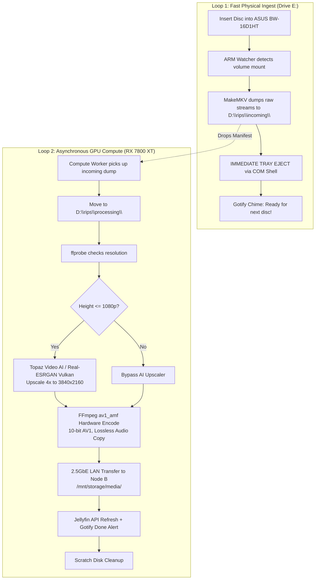

# Automatic Ripping Machine (A.R.M.) & 4K AI Upscaling Pipeline

## 1. Executive Summary & Problem Statement

This project integrates the open-source **Automatic Ripping Machine (A.R.M.)** ecosystem ([automatic-ripping-machine/automatic-ripping-machine](https://github.com/automatic-ripping-machine/automatic-ripping-machine)) into Owen's distributed homelab, solving the critical throughput bottleneck of physical optical disc ingestion.

### The Bottleneck Mismatch
In conventional single-threaded ripping workflows:
- **Raw MakeMKV Extraction:** 15–25 minutes at 6x–8x BD-ROM transfer speed.
- **AI Super-Resolution & Transcoding:** 1.5–3 hours per 2-hour 1080p feature film (frame-by-frame 4x AI upscaling via Real-ESRGAN Vulkan / Topaz Video AI on the 16GB RX 7800 XT, followed by 10-bit AV1 compression).

If the optical drive tray remains closed until encoding completes, the physical drive sits idle and locked for 85% of the total time. Owen can only rip 2 to 3 discs per day even if physically present at the computer.

### The Solution: Decoupled Two-Loop Architecture
By decoupling physical disc reading from heavy GPU compute:
1. **Drive Ingest Loop (Fast):** MakeMKV extracts raw bit-for-bit video streams to Node A's scratch storage (`D:\rips\incoming\`). **The tray immediately ejects upon raw dump completion (< 20 minutes)** and chimes via Gotify. Owen can immediately insert the next disc in the series (e.g., *Avatar: The Last Airbender* Disc 3) back-to-back.
2. **GPU Compute Queue (Asynchronous):** A background worker daemon continuously watches for completed dumps, moves them to `D:\rips\processing\`, evaluates video resolution via `ffprobe`, executes AI super-resolution on sub-4K streams ($\le 1080p$), encodes hardware AV1 via AMD AMF (`av1_amf`), transfers the final asset over the dedicated 2.5GbE switch (`192.168.4.1`) to Node B `/mnt/storage/media/`, and refreshes Jellyfin.

---

## 2. Hardware Profile & Storage Layout

| Component | Node / Device | Specification | Role |
| :--- | :--- | :--- | :--- |
| **Optical Drive** | Node A (`E:`) | **ASUS BW-16D1HT USB Device** | LibreDrive UHD-friendly firmware; reads Blu-ray & 4K UHD with AACS 2.0/2.1 |
| **Ingest CPU** | Node A | AMD Ryzen 7 5700X3D (8C/16T) | Multi-stream MakeMKV demuxing & I/O management |
| **Scratch Disk** | Node A (`D:`) | Mass Hard Drive (2.85 TB free space) | Staging directories: `D:\rips\incoming\`, `processing\`, `completed\` |
| **Compute GPU** | Node A | AMD Radeon RX 7800 XT (16 GB VRAM) | Vulkan AI super-resolution & AMF AV1 hardware encoding |
| **Media Host** | Node B (`mini-1`) | Intel Core Ultra 5 125H, 3.6TB SSD | 24/7 NAS storage (`/mnt/storage/media/`), Jellyfin server |
| **Switch Link** | Node A $\leftrightarrow$ Node B | Direct 2.5GbE switch (`192.168.4.0/24`) | Line-rate 280 MB/s asset transfer between nodes |

---

## 3. Directory Layout on Node A (`D:\rips\`)

```
D:\rips\
├── incoming\       # MakeMKV dumps raw streams here; monitored for new dumps
├── processing\     # Currently undergoing AI upscaling and AV1 encoding
├── completed\      # Encoded 4K AV1 MKV files ready for transfer
├── failed\         # Quarantined rips if errors occur
└── logs\           # Detailed MakeMKV, Topaz/Real-ESRGAN, and FFmpeg logs
```

---

## 4. Pipeline Stages



---

## 5. Execution & Operational Commands

### Starting the Ingest Watcher (Loop 1)
```powershell
python work/projects/arm/arm_drive_watcher.py --config work/projects/arm/arm_config.yaml
```

### Starting the Compute Worker (Loop 2)
```powershell
python work/projects/arm/arm_compute_worker.py --config work/projects/arm/arm_config.yaml
```

### Running Unit Tests
```bash
pytest work/projects/arm/tests/test_arm_pipeline.py -v
```
